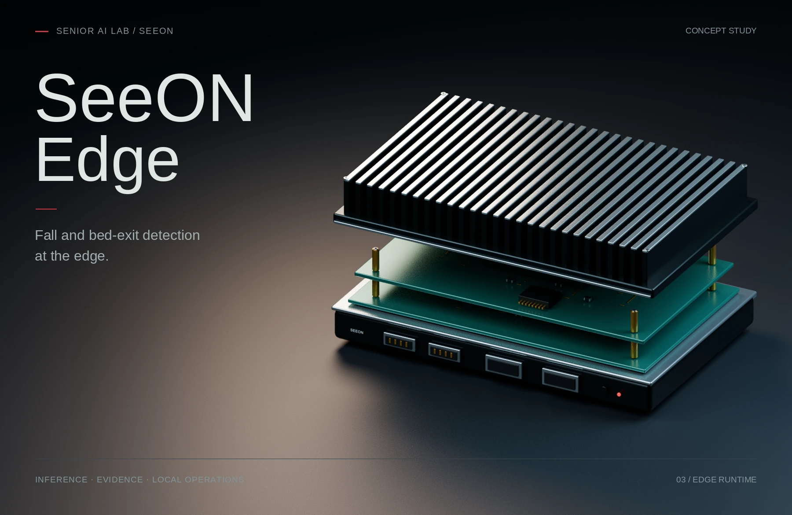

<p align="center">
  
</p>

<p align="center"><sub>SENIOR AI LAB · SEEON</sub></p>

<h1 align="center">SeeON Edge</h1>

<p align="center">
  <strong>카메라 영상에서 낙상·침대 이탈 이벤트를 해석하는 엣지 런타임</strong><br />
  RTSP 처리, 이벤트·증거 전달, 엣지 운영 대시보드
</p>

<p align="center">
  <a href="#개요">개요</a> ·
  <a href="#저장소-구성">저장소 구성</a> ·
  <a href="#개발-시작하기">개발 시작하기</a> ·
  <a href="#테스트와-검증">테스트와 검증</a> ·
  <a href="#엣지-배포">엣지 배포</a> ·
  <a href="./docs/architecture.md">아키텍처</a>
</p>

## 개요

SeeON Edge는 카메라가 제공하는 RTSP 스트림을 NVIDIA DeepStream Flow 워커에서 처리하고, 낙상·침대 이탈 판단과 운영 상태를 엣지 API로 전달하는 저장소입니다. FastAPI 서비스(`ml-api`), Python 워커(`ml-worker`), React 운영 화면이 한 호스트의 Docker Compose 배포 단위를 이룹니다.

이 저장소의 `backend/`는 **현장 엣지 API**입니다. 제품 API를 소유한 [SeeON-Backend](https://github.com/SeniorAILab/SeeON-Backend)와는 다른 서비스이며, 엣지 API가 Hub와 HTTPS로 통신합니다. 운영 화면은 이 저장소의 `front/`에 포함되고, 시설용 제품 화면은 별도 저장소인 [SeeON-Front](https://github.com/SeniorAILab/SeeON-Front)에서 관리됩니다.

> 이 문서는 저장소에서 확인한 현재 코드와 설정을 설명합니다. 현장 배포 승인, 임상적 효능, 정확도·성능 수치 또는 운영 준비 상태를 보증하지 않습니다.

## 저장소 구성

| 경로 | 책임 |
| --- | --- |
| `worker/` | Flow 미디어 처리, 추적 메타데이터 해석, 낙상·침대 이탈 도메인 판단, 증거 생성 및 엣지 API 전달 |
| `backend/` | 카메라·정책·운영 상태 API, 대시보드 인증, PostgreSQL 저장, 워커 릴레이 및 Hub 연동 |
| `front/` | 엣지 운영 대시보드. 동일 출처의 `/api/v1` API만 호출하며 RTSP 주소나 파일 경로를 브라우저에서 직접 열지 않음 |
| `shared/` | 워커와 엣지 API가 사용하는 이벤트·정책·전송 계약 및 제한된 로컬 전달 큐 |
| `contracts/` | 프레임·이벤트·릴레이 등 프레임워크 독립 계약의 기준 위치 |
| `docs/` | [아키텍처](./docs/architecture.md), [결정 기록](./docs/decisions/README.md), 이미지 출처 |
| `worker/tools/fetch_models/` | 매니페스트에 고정된 외부 모델 파일의 다운로드 및 SHA-256 검증 도구 |

워커와 엣지 API는 서로의 Python 패키지를 가져오지 않습니다. 두 프로세스는 HTTP와 명시된 wire 계약으로 통신하며, PostgreSQL 연결은 엣지 API만 소유합니다. 제품·데이터·모델의 별도 책임은 [관련 저장소](#관련-저장소)를 참고하세요.

## 개발 시작하기

### 준비물

- Python 개발 버전: 저장소의 `.python-version`에 지정된 Python 3.12와 [uv](https://docs.astral.sh/uv/)
- 프런트 개발: Node.js와 `pnpm@10.32.1` (버전은 `front/package.json`의 `packageManager` 기준)
- 실제 카메라 추론: 호환되는 NVIDIA 드라이버·Docker GPU 전달 환경·DeepStream. 일반 macOS/CPU 개발 환경만으로 배포 워커를 실행할 수는 없습니다.

저장소 루트에서 Python 개발 의존성을 동기화하고 예제 YAML만 검증합니다.

```bash
uv sync
uv run python -m worker --config worker/ml-worker.example.yaml --check-config
```

`uv sync`는 루트 `pyproject.toml`의 기본 `test` 및 `worker` 그룹도 설치합니다. `--check-config`는 YAML 형식과 필드 검증만 수행하며 카메라 연결, 릴레이 인증, 모델 로딩, GPU·DeepStream 동작을 확인하지 않습니다. `worker/ml-worker.example.yaml`은 개발·점검용 예제입니다. 실제 카메라 로스터는 운영 중 엣지 API에서 동기화하며, 환경 변수나 YAML로 시설 로스터를 배포하지 않습니다.

프런트 개발 서버는 엣지 API가 로컬 `127.0.0.1:8000`에서 동작하는 경우 다음처럼 실행할 수 있습니다.

```bash
pnpm --dir front install --frozen-lockfile
ML_API_PROXY_TARGET=http://127.0.0.1:8000 pnpm --dir front dev
```

이 명령은 프런트 개발 서버만 실행합니다. API에는 PostgreSQL 스키마와 권한 설정이 필요하며, Vite 개발 서버는 `0.0.0.0`에 바인딩되므로 신뢰할 수 있는 개발 네트워크에서만 사용하세요.

## 테스트와 검증

저장소 루트에서 필요한 검증을 선택해 실행합니다.

```bash
# 전체 Python 테스트
uv run pytest -q

# CI에서 제외하는 real-stack / heavy / integration / private_bundle 외 테스트
uv run pytest -q -m "not real_stack and not heavy and not integration and not private_bundle"

# Python 정적 검사와 패키지 경계
uv run --group lint ruff check .
uv run --group lint lint-imports
uv run --group lint mypy contracts shared

# 프런트 테스트, 빌드, 린트
pnpm --dir front test
pnpm --dir front build
pnpm --dir front lint
```

전체 테스트에는 실제 서비스·하드웨어·외부 상태를 전제로 하는 마커가 있습니다. 해당 테스트는 필요한 환경을 따로 준비한 뒤 실행하세요. 프런트의 `test:e2e`도 실제 스택 검증이며 단위 테스트와 다릅니다.

## 엣지 배포

배포 스택은 단일 Linux 엣지 호스트를 전제로 합니다. Docker Compose 플러그인, NVIDIA GPU 전달이 가능한 호스트, 카메라 네트워크 접근, Hub HTTPS 접근, 모델 소스 접근이 필요합니다. Compose는 PostgreSQL, 초기 DB 프로비저닝, 모델 다운로드, TensorRT 엔진 준비, `ml-api`, `ml-worker`를 구성합니다. 프로덕션 워커 프로파일은 `flow` 하나이며 CPU/OpenCV 폴백은 제공되지 않습니다.

1. 예제 환경 파일을 복사하고 운영 값과 비밀 파일 경로를 안전하게 설정합니다.

   ```bash
   cp .env.edge.prod.example .env.edge.prod
   ```

   `COMPOSE_PROJECT_NAME`은 기존 스택과 동일하게 유지해야 합니다. 값이 달라지면 Compose가 다른 데이터 볼륨을 선택할 수 있습니다. `ML_API_IMAGE`와 `ML_WORKER_IMAGE`에는 릴리스 과정에서 검증한 실제 이미지 참조를 지정하고 `latest`·`dev` 같은 부동 태그는 피하세요. 예제의 `<git-sha>`는 자리표시자이며 이미지 게시나 존재를 보증하지 않습니다.

2. PostgreSQL 비밀번호·DSN은 환경 파일에 넣지 말고 권한을 `0600`으로 제한한 별도 소유자 전용 파일로 제공하세요. 대시보드 초기 계정과 릴레이 토큰은 사이트마다 새 값으로 설정하고, `.env.edge.prod`와 비밀 파일을 저장소에 커밋하지 마세요. 카메라 등록은 엣지 대시보드에서 수행합니다.

3. 사전 검사를 통과한 뒤 스택을 시작합니다.

   ```bash
   scripts/edge-preflight/check-env.sh .env.edge.prod
   docker compose --env-file .env.edge.prod -f compose.edge.yaml up -d
   ```

   사전 검사는 Compose 구성이 렌더링되는지, 필수 값·Hub HTTPS·대시보드 초기 인증·RTSP 목적지 정책을 만족하는지 확인합니다. 이 검사는 실제 이미지의 존재나 현장 동작을 보증하지 않습니다. `ml-api`의 호스트 포트는 `127.0.0.1:8000`에만 바인딩되며 PostgreSQL과 워커 포트는 호스트에 공개되지 않습니다.

4. 배포 후 `GET /health/live`, `GET /health/ready`, 엣지 대시보드의 카메라·워커 상태를 확인합니다. 실제 영상, 모델, 증거 저장과 Hub 전달 여부는 해당 사이트의 승인된 점검 절차로 별도 확인하세요.

> `compose.edge.yaml` 상단 주석은 `compose.edge.nvidia.yaml`을 언급하지만, 이 체크아웃에는 해당 파일이 없습니다. 확인 가능한 `compose.edge.yaml` 자체에 GPU 예약 설정이 있으며 위 명령은 체크인된 파일만 사용합니다. 존재하지 않는 오버레이를 임의로 추가했다고 가정하지 마세요.

## 보안 및 운영 경계

- `API_BACKEND_BASE_URL`은 Hub HTTPS 주소를 사용해야 합니다. 운영 환경에서 평문 HTTP 허용 플래그를 켜지 마세요.
- LAN 카메라 허용이 필요한 경우 RTSP 목적지 정책을 검토하세요. 로컬·링크 로컬 목적지 허용 설정은 운영에서 사용하지 않습니다. RTSP URL에는 자격 증명이 포함될 수 있으므로 문서·이슈·로그에 기록하지 마세요.
- `API_EDGE_RELAY_TOKEN`, 대시보드 초기 자격 증명, PostgreSQL 비밀 파일은 환경·비밀 저장소에서 관리하고 로그나 프런트 번들에 포함하지 마세요.
- 클립과 스냅샷은 민감한 영상 증거입니다. 호스트 저장소 접근권한·백업·보존 정책은 운영 조직이 정해야 합니다. API는 클립 저장소를 읽기 전용으로, 워커는 기록용으로 마운트합니다.
- 애플리케이션 상태 볼륨을 제거하는 `docker compose down -v`를 사용하지 마세요. 데이터베이스·워커 큐·증거 저장소는 서로 다른 용도이며 이미지 교체만으로 백업이나 마이그레이션이 대체되지 않습니다.

## 관련 저장소

- [SeeON-Edge](https://github.com/SeniorAILab/SeeON-edge) — 이 저장소
- [SeeON-Backend](https://github.com/SeniorAILab/SeeON-Backend) — 제품 API 및 서버 측 워크플로
- [SeeON-Front](https://github.com/SeniorAILab/SeeON-Front) — 제품 사용자 인터페이스
- [SeeON-Model](https://github.com/SeniorAILab/SeeON-Model) — 모델 관련 작업
- [SeeON-Dataset](https://github.com/SeniorAILab/SeeON-Dataset) — 데이터 관련 작업

## 라이선스

이 저장소의 프로젝트 라이선스는 AGPL-3.0-only입니다. 자세한 조건은 [`LICENSE`](./LICENSE)를 확인하세요. README 상단 이미지는 제품 동작이나 실제 카메라 장면을 나타내지 않는 개념 아트입니다. [이미지 출처](./docs/assets/ARTWORK.md).
