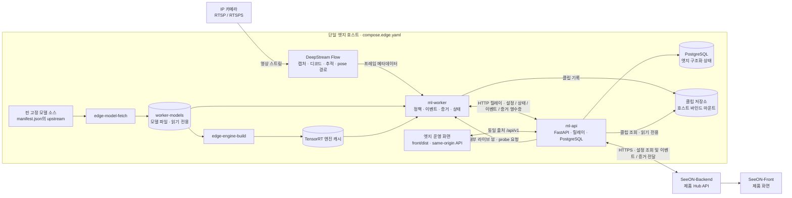
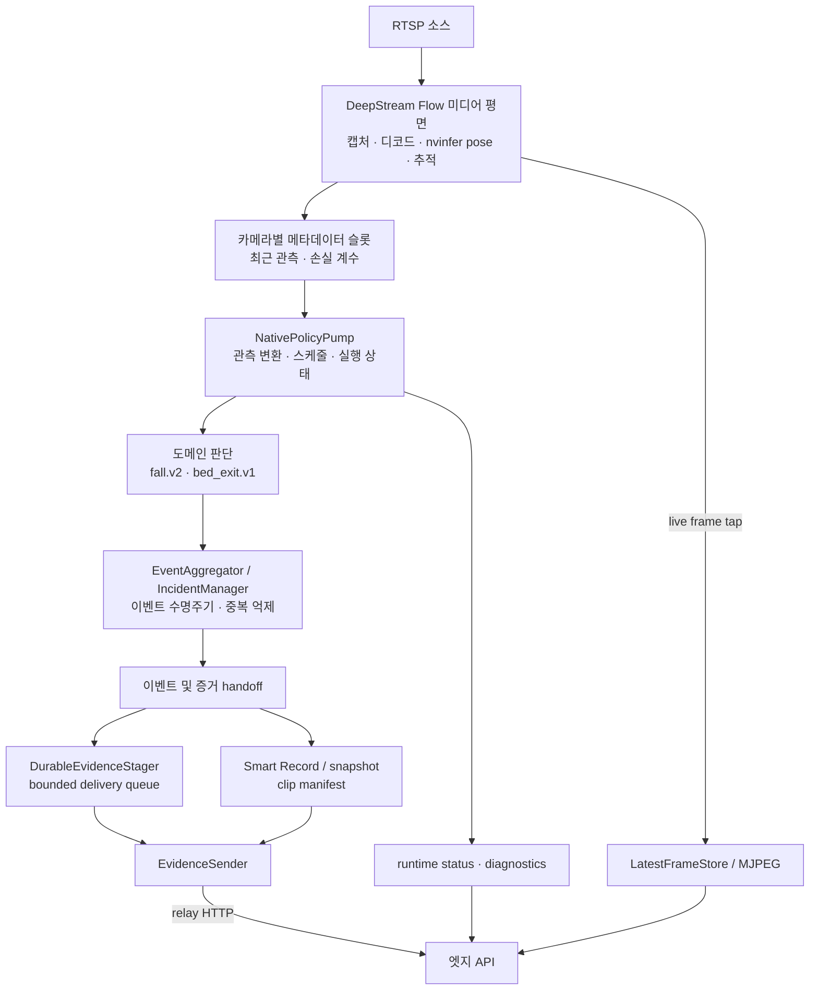
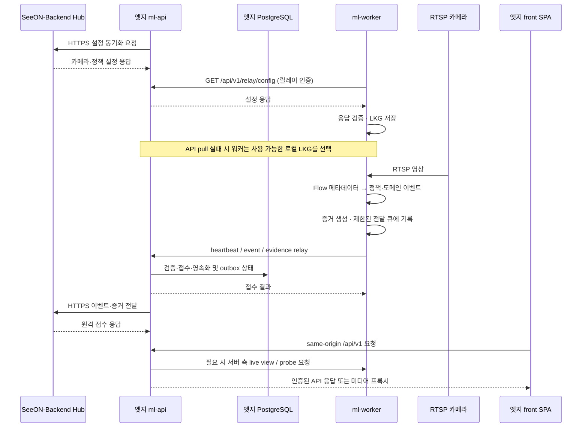

# SeeON Edge 아키텍처

이 문서는 저장소에서 확인한 현재 구현을 설명합니다. 현재 런타임은 Python 기반 FastAPI 엣지 API, DeepStream Flow 워커, React 운영 화면입니다. 미래 아키텍처 제안이나 별도 제품·모델 저장소의 기능을 현재 배포된 기능으로 간주하지 않습니다.

## 시스템 맥락

지원되는 Compose 배포 단위는 Linux 엣지 호스트 한 대에 `ml-api`, PostgreSQL, `ml-worker` 각 한 인스턴스를 두는 형태입니다. 엣지 API는 엣지의 운영 데이터베이스이자 중앙 Hub와의 네트워크 경계이고, 워커는 카메라 영상을 소비해 결과를 엣지 API로 보냅니다.

`front/`는 이 저장소의 엣지 운영 화면이며 `SeeON-Front` 제품 화면과 다릅니다. 브라우저는 엣지 API만 호출합니다. 워커가 Hub나 PostgreSQL에 직접 연결하지 않고, RTSP 카메라로부터 영상을 게시하는 서버도 이 저장소에 포함되지 않습니다.

## 구성 요소와 책임

| 요소 | 현재 책임 | 경계 |
| --- | --- | --- |
| `worker/` · `ml-worker` | Flow 미디어 평면, 카메라별 관측·정책 상태, 낙상·침대 이탈 해석, 이벤트·증거 생성, 릴레이 전송 | PostgreSQL을 열거나 DB 스키마를 관리하지 않음. 유일한 프로덕션 프로파일은 `flow` |
| `backend/` · `ml-api` | 카메라·정책·운영 설정 API, 워커 설정 응답, 릴레이 인증·접수, 상태·클립 카탈로그, Hub 연동 | PostgreSQL 접속과 트랜잭션 소유자. Hub로 나가는 서비스 측 HTTP 클라이언트 |
| `front/` | 엣지 운영자용 SPA: 세션, 카메라, 이벤트·증거, 운영 상태·설정 | same-origin `/api/v1` 사용. 워커 포트, RTSP, 호스트 파일시스템에 직접 접근하지 않음 |
| `shared/` | 이벤트 wire, 전송 분류, 워커 설정 정책, 파일 기반 전달 큐 | 런타임·DB·카메라 소유자가 아님 |
| `contracts/` | 계층 사이에서 공유하는 타입·이벤트·프로토콜 어휘 | 프레임워크와 I/O에 독립적인 계약 leaf |

워커와 API는 소스 코드 의존성이 아니라 HTTP와 명시적 데이터 계약으로 결합됩니다. 워커 내부에서는 `worker/runtime/`만 전체 런타임을 조립하고, DeepStream SDK 의존은 `worker/adapters/deepstream/`에 격리됩니다. 대시보드 인증은 서버가 설정하는 세션 쿠키를 사용하며 클라이언트에 릴레이 토큰을 저장하지 않습니다.

## 워커의 프레임 처리 및 이벤트 흐름

워커의 유일한 프로덕션 시작 명령은 `python -m worker`입니다. `worker/__main__.py`가 설정을 확인하고 `WorkerRuntime`을 생성합니다. `WorkerRuntime`은 하나의 프로세스 공유 Flow 미디어 평면과 여러 카메라별 CPU 정책·이벤트·증거 상태를 조립합니다. 프로세스 공유 모델 컴포넌트를 카메라마다 재사용하되, 시간에 따라 변하는 판단 상태는 카메라별로 분리합니다.

DeepStream Flow가 영상 수집, 디코드, GPU pose 경로와 추적 메타데이터를 소유합니다. Python 워커는 Flow 메타데이터를 수치 관측으로 변환하고, 등록된 도메인 모듈(`fall.v2`, `bed_exit.v1`)과 이벤트 집계 정책을 적용합니다. 이는 추적기나 GPU 처리 경로를 Python 계층에서 다시 구현한다는 뜻이 아닙니다.

### 픽셀과 판단 입력의 경계

- `worker/types/frame_packet.py`의 `FramePacket`은 이미지가 필요한 추출, 미리보기, 스냅샷·증거 경로를 위한 이미지 소유 봉투입니다.
- 도메인 판단은 `DecisionInput`의 관측·좌표·시각 정보 등 수치 자료를 받습니다. 결정 경로에 원본 이미지 버퍼나 프레임 핸들을 전달하지 않습니다.
- `BusinessEvent`는 도메인 판단의 결과이며, 이벤트에 스냅샷이 필요한 경우 명시적인 제한 크기 JPEG 증거로만 전달됩니다. 스냅샷 실패가 알림 판정을 취소하지는 않지만 증거는 누락 또는 불완전할 수 있습니다.
- 관측 슬롯과 temporal state는 카메라 단위입니다. 프로세스 공유 모델, 설정·LKG, GPU lease, 전달 큐는 별도 공유 수명주기를 갖습니다.

### 모델 수명주기

모델 파일은 저장소나 런타임 이미지의 소스 코드가 아닙니다. `worker/tools/fetch_models/manifest.json`이 upstream 리비전/태그, 파일 크기와 SHA-256을 고정하며, Compose의 `edge-model-fetch`가 별도 모델 볼륨에 내려받아 검증합니다. 모델 볼륨은 워커에 읽기 전용으로 연결됩니다. GPU가 필요한 `edge-engine-build` 단계가 pose ONNX와 이미지에 포함된 parser/config로 엔진을 준비하고, 워커는 소스 활성화 전에 엔진 identity·digest·batch 정보를 확인하고 실제 warmup을 수행합니다. 부팅 중에 워커가 임의로 엔진을 생성하거나 CPU 경로로 조용히 전환하지 않습니다.

이 저장소는 추론 실행과 배포 아티팩트 검증을 담당합니다. 모델 학습 및 데이터 수집·정답·평가의 소유권은 여기 있지 않습니다. 현재 Python 코드는 향후 ADR의 설계 목표를 대신하지 않습니다.

## API, 대시보드 및 Hub 계약

엣지 API는 Hub의 `API_BACKEND_BASE_URL`을 기준으로 HTTPS 설정 동기화를 수행하고, 자체 outbox를 통해 이벤트·증거를 Hub에 전달합니다. 워커는 같은 Compose 네트워크의 엣지 API와만 통신하며, Hub URL이나 제품 DB 연결을 갖지 않습니다. 로컬 API의 접수와 원격 Hub의 접수는 다른 단계입니다. 로컬 응답만으로 Hub가 이벤트를 수신했다고 단정하지 않습니다.

| 계약 표면 | 소유 위치 | 용도 |
| --- | --- | --- |
| 버전이 있는 이벤트·릴레이 데이터 타입 | `contracts/event.py`, `contracts/relay.py` | 공유 이벤트 유형 및 릴레이 payload |
| 이벤트 생성, HTTP 전송·실패 분류 | `shared/events/schemas.py`, `edge_ingest_client.py`, `evidence_export_client.py`, `evidence_export_contract.py` | 워커→엣지 API 및 API→Hub 경계 |
| 정책 bundle 파싱·식별 | `shared/detection_policies.py` | API가 저장한 버전 정책을 워커가 같은 규칙으로 검증 |
| 워커 설정 응답·수신 | `backend/app/features/relay/router.py`, `worker/runtime/config/config_pull.py` | 워커의 카메라·정책 설정과 LKG fallback |
| 워커 live-view HTTP | `worker/pipeline/output/live_view_api.py`, `backend/app/features/cameras/streams_router.py` | API 서버가 미리보기·probe 등 워커 표면을 호출 |
| 클립 manifest 생산·소비 | `worker/pipeline/output/evidence/manifest_models.py`, `backend/app/features/clips/manifest.py` | 워커 산출물과 API 클립 카탈로그 간 계약 |
| 브라우저 API 클라이언트 | `front/src/shared/api/client.ts`, `front/src/shared/api/session.ts` | 세션 기반 same-origin API와 미디어 URL |

워커와 API 사이의 내부 호출 계약은 공용 Python 패키지를 서로 가져오게 하지 않습니다. `tests/test_backend_worker_runtime_contracts.py`는 두 쪽의 route·manifest·응답 파싱이 함께 맞는지 확인하는 drift guard입니다. `contracts/`는 이 저장소의 기준입니다. 별도 데이터 저장소의 사본이 기준 소스는 아닙니다.

## 저장소와 영속성 경계

PostgreSQL은 엣지 API가 소유하는 구조화 애플리케이션 상태의 기준 저장소입니다. 이것이 엣지 호스트의 유일한 지속 파일이라는 뜻은 아닙니다. 워커는 재전송용 제한 큐를 보유하고, 클립 저장소는 영상 파일과 manifest를 보유합니다.

| 저장 영역 | 소유자·기록 방식 | 경계와 주의점 |
| --- | --- | --- |
| PostgreSQL product·delivery schema | `backend/app/edge_db/`; 엣지 API만 접속 | `edge-db-migrator`가 프로비저닝하며 authority token/generation으로 쓰기를 fence함. 워커는 DB 자격 증명·DDL 권한이 없음 |
| PostgreSQL diagnostics schema | 엣지 API의 별도 진단 저장 경로 | 옵션 실행 기록이며 설정된 보존 예산에 따름. 활성화 시 필수 용량 값을 추측하지 말 것 |
| API 상태 볼륨 | Compose `edge-state` | API가 소유하는 서비스 상태. worker state 및 PostgreSQL data와 별도 |
| 워커 상태 볼륨 | Compose `worker-local-state`, `--state-dir` | 설정 LKG, GPU lease, publish-once 전달 큐 등. 컨테이너 쓰기 레이어에 두면 교체 시 대기 증거가 사라질 수 있음 |
| 클립 저장소 | 호스트 디렉터리를 컨테이너의 `/var/lib/clip-store`에 연결 | 워커는 기록, API는 읽기 전용. 클립·스냅샷·메타데이터에는 민감한 영상 증거가 포함될 수 있음 |
| 모델 파일 볼륨 | `edge-model-fetch`가 씀, 워커는 읽기 전용 | 매니페스트의 크기와 해시가 맞지 않으면 모델 provision이 실패함. 소스 트리에 모델 가중치를 커밋하지 않음 |
| TensorRT 엔진 캐시 | `edge-engine-build`가 사전 생성 | 이미지·ONNX·batch identity를 부팅 시 검증. 호스트 교체나 설정 변경 시 재생성이 필요할 수 있음 |

워커 전달 큐는 파일 기반이며 크기와 항목 수가 제한됩니다. 재시도 대상 실패는 재전송하고, 호환성 실패는 재확인하며, 영구 payload 오류는 dead-letter로 분류합니다. 큐가 가득 차면 기존 항목을 조용히 버리는 대신 새 항목 admission이 거부될 수 있습니다. 따라서 “모든 오류에서 이벤트가 무손실”이라고 보장하지 않습니다.

현재 API 런타임은 PostgreSQL만 사용합니다. `backend/app/edge_db/migration/`은 퇴역 SQLite 자료를 일회성 cutover로 가져오기 위한 별도 운영 경로입니다. 일반 요청·워커 동기화·릴레이는 SQLite 파일을 mailbox나 주 저장소로 사용하지 않습니다. DB 볼륨 삭제, `docker compose down -v`, 직접 SQL 수리는 복구 절차가 아닙니다.

## 오류와 복구 동작

| 오류 상황 | 동작 범위 | 현재 동작 |
| --- | --- | --- |
| 잘못된 설정 또는 로컬 YAML 해석 실패 | 워커 전체 | 일반 설정 오류는 exit 2. 설정 source를 운영할 때 YAML은 개발용 escape hatch |
| 설정 pull 실패, 유효한 LKG 존재 | 워커 전체 | 검증된 마지막 설정으로 동작할 수 있고 stale/degraded 상태를 노출 |
| 설정 pull 실패, 사용 가능한 LKG 없음 | 워커 전체 | 설정 해석을 거부하고 시작하지 않음 |
| Flow 엔진/배치 identity 불일치, 모델 로드·warmup 또는 필수 bootstrap 단계 실패 | 워커 전체 | 카메라 활성화 전에 시작 거부, 일반적으로 exit 3 |
| 실행 중 회복 불가능한 GPU/가속기 오류 | 워커 전체 | 첫 오류를 기록하고 exit 4로 종료하여 supervisor가 재시작하도록 함 |
| RTSP 접속·인증·stream stall | 해당 카메라 | 해당 카메라를 degraded/offline으로 관찰하고 재시도하며 다른 카메라 정책 상태와 분리 |
| 한 프레임 처리·추출 실패 | 해당 입력 경로 | 프레임을 버리고 처리 루프를 계속할 수 있음. CPU/OpenCV로 조용히 우회하지 않음 |
| clip 인코딩·snapshot 생성 실패 | 증거 | 알림 결정을 막지 않으며 증거 상태가 불완전하거나 없을 수 있음 |
| 릴레이 네트워크·서버 오류 | 전달 단계 | 분류된 재시도와 로컬 bounded queue에 의존. 큐 용량 초과나 영구 오류는 자동 무손실 복구가 아님 |
| Hub 연결 장애 | API↔Hub 동기화 | 설정 freshness 및 원격 전달이 지연될 수 있음. 로컬 접수와 Hub 접수를 별도 확인 |
| PostgreSQL 미준비·쓰기 거부 | API | 의존 서비스의 health/readiness와 API 동작에 영향을 줌. 워커 DB fallback은 없음 |

워커 CLI 종료 코드는 `0` 정상 종료, `1` 일반 런타임 오류, `2` 설정·해석 오류, `3` 시작 거부, `4` fatal accelerator입니다. `--check-config`는 입력 설정만 검증하며 실제 모델 warmup·GPU·RTSP·Hub 연동 검증을 대신하지 않습니다.

## 보안과 배포 가정

- Compose는 `ml-api` 호스트 포트만 `127.0.0.1:8000`에 바인딩합니다. PostgreSQL과 워커 서비스 포트는 Compose 내부 네트워크에만 둡니다. 원격 운영 접속은 승인된 TLS·접근 제어 경계 뒤에 두고 이 포트를 인터넷에 직접 공개하지 마세요.
- 외부 Hub base URL은 HTTPS여야 합니다. 평문 HTTP 허용은 로컬 fixture에만 제한되며 프로덕션 사전 검사에서 거부됩니다.
- `API_EDGE_RELAY_TOKEN`과 워커의 `RELAY_TOKEN`은 같은 사이트별 비밀입니다. 대시보드 bootstrap 계정도 사이트별로 정하고 알려진 기본값을 쓰지 않습니다. PostgreSQL 비밀번호·DSN은 별도 소유자 전용 파일로 전달합니다.
- RTSP URL은 사용자 정보(credentials)를 포함할 수 있습니다. 이를 Git, shell history, 이슈, 로그에 기록하지 마세요. 사설 목적지 허용은 카메라 LAN이 필요한 배포에서만 검토하고, 로컬·link-local 허용 정책은 운영에 켜지 않습니다.
- 카메라 roster와 시설 identity는 엣지 대시보드/API에서 관리합니다. 예제 YAML·환경 변수로 시설 명단을 주입하지 않습니다.
- Compose의 `COMPOSE_PROJECT_NAME`은 기존 상태 볼륨에 연결되는 배포 식별자입니다. 업그레이드 때도 동일하게 유지하고, 이미지는 부동 `latest`/`dev` 태그에 의존하지 마세요. 롤백은 상태 볼륨을 보존하는 이미지 변경이어야 합니다.
- 클립 저장소, 모델 파일, DB와 워커 상태는 별도 저장 영역입니다. 접근권한·백업·보존 기간은 운영 주체가 정해야 하며 이 저장소는 데이터의 보존 적정성을 보증하지 않습니다.

## 알려진 한계

- 엣지 추론의 프로덕션 경로는 NVIDIA DeepStream Flow입니다. CPU 전용 호스트, 일반 노트북 또는 macOS에서 실제 프로덕션 카메라 파이프라인을 실행할 수 있다는 의미가 아닙니다.
- 테스트 통과나 API health는 특정 카메라·설치·모델 조합의 정확도, 재현율, 지연시간, 용량 또는 현장 적합성을 증명하지 않습니다. 이 문서는 성능 benchmark나 임상·안전 인증을 제시하지 않습니다.
- `compose.edge.yaml` 상단 주석이 `compose.edge.nvidia.yaml`을 지칭하지만 이 저장소에는 해당 파일이 없습니다. 확인한 기본 Compose 파일 자체에는 GPU 예약 설정이 있습니다. 다른 오버레이 배포 구성을 가정하지 마세요.
- `docs/decisions/0009-rust-worker-postgresql.md`는 아직 qualification/deployment 전인 목표를 기록합니다. 현재 실제 워커는 Python `worker/`이며 Rust 워커가 제공된다고 볼 수 없습니다.
- 서비스 구성은 단일 호스트·단일 API·단일 워커 Compose 배포를 설명합니다. 다중 엣지 스케일아웃, 운영 가용성 SLA, 모델 정확도, 데이터 보존 정책은 이 문서에서 보장하지 않습니다.

## 소스 맵

| 관심사 | 기준 소스 | 확인할 내용 |
| --- | --- | --- |
| 엣지 API 조립·SPA 제공 | `backend/app/main.py` | 라우터, health probe, `front/dist` mount |
| API 시작·PostgreSQL·Hub 작업 | `backend/app/bootstrap/lifespan.py`, `backend/app/edge_db/root.py` | DB 연결, 설정 동기화, outbox 수명주기 |
| 로컬 데이터 스키마·이전 | `backend/app/edge_db/` | PostgreSQL DDL과 legacy SQLite migration 경계 |
| 카메라·워커 설정·정책 | `backend/app/features/cameras/`, `backend/app/features/detection_settings/`, `shared/detection_policies.py` | registry와 worker config 구성 |
| 릴레이 API | `backend/app/features/relay/router.py` | token 검증, 설정·이벤트·heartbeat 경로 |
| 워커 CLI·프로세스 조립 | `worker/__main__.py`, `worker/runtime/worker.py` | 진입점, Flow 활성화, 런타임 수명주기 |
| Flow SDK 경계·메타데이터 | `worker/adapters/deepstream/`, `worker/runtime/flow/media_plane.py` | 외부 SDK, 소스, 프레임·metadata handoff |
| 관측·도메인·이벤트 수명주기 | `worker/runtime/flow/policy_pump.py`, `worker/pipeline/perception/`, `worker/domains/`, `worker/pipeline/decision/` | 카메라별 정책과 fall/bed-exit 이벤트 |
| 증거·라이브 뷰 | `worker/pipeline/output/evidence/`, `worker/pipeline/output/live_view_api.py` | smart recording, manifest, queue 전송, preview API |
| 이벤트 wire·전달 큐 | `shared/events/`, `contracts/event.py`, `contracts/relay.py` | 데이터 shape, bounded transport, failure 분류 |
| 모델·엔진 provision | `worker/tools/fetch_models/manifest.json`, `compose.edge.yaml` | 외부 리비전·digest 및 사전 엔진 구성 |
| 엣지 UI·API client | `front/src/app/App.tsx`, `front/src/shared/api/` | 운영 화면, same-origin API·session boundary |

## 관련 문서와 저장소

- [README](../README.md) — 개발 시작, 테스트, 배포 사전 조건
- [결정 기록](./decisions/README.md) — 기술 결정과 상태
- [SeeON-Backend](https://github.com/SeniorAILab/SeeON-Backend) — 제품 서버 경계
- [SeeON-Front](https://github.com/SeniorAILab/SeeON-Front) — 제품 사용자 화면
- [SeeON-Model](https://github.com/SeniorAILab/SeeON-Model) — 모델 관련 작업
- [SeeON-Dataset](https://github.com/SeniorAILab/SeeON-Dataset) — 데이터 관련 작업
